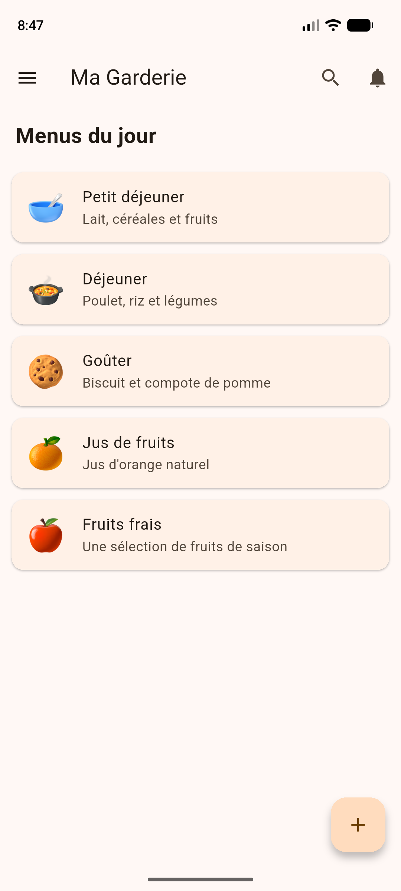
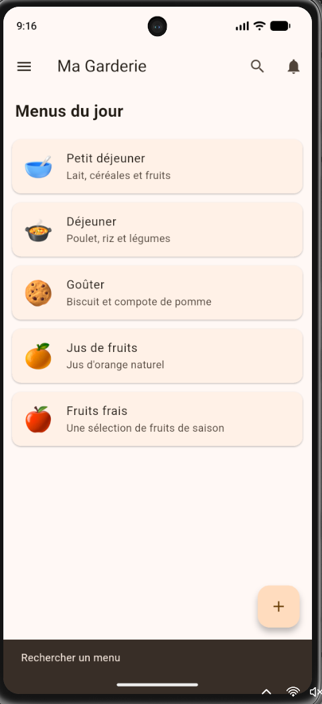
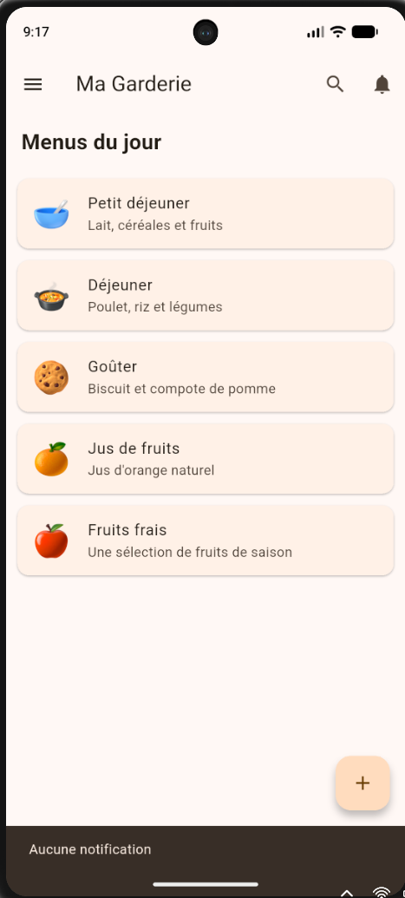
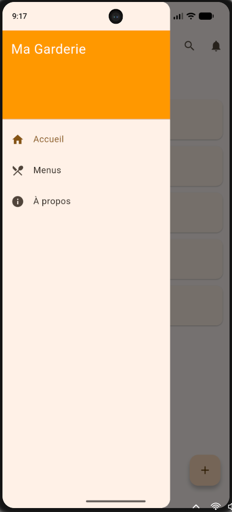

# Ma Garderie 🧒

Application mobile de gestion des menus d'une garderie d'enfants.
Elle affiche les menus de la journée (petit déjeuner, déjeuner, goûter, etc.)
avec navigation par Drawer et interactions simples. Les données sont
déclarées localement, sans backend ni authentification.

## Technologies utilisées
- Flutter / Dart
- Material Design 3
- Git et GitHub (une branche par fonctionnalité, fusion dans `main`)

## Installation et exécution
1. Installer [Flutter](https://docs.flutter.dev/get-started/install)
2. Cloner le dépôt :
```bash
   git clone https://github.com/ghofran2002/garderie_mobile_g2.git
   cd garderie_mobile_g2
```
3. Installer les dépendances : `flutter pub get`
4. Lancer sur un émulateur ou un appareil : `flutter run`

## Fonctionnalités
- Splash screen avec redirection automatique après 3 secondes
- AppBar avec boutons Recherche et Notifications
- Drawer (Accueil, Menus, À propos)
- Liste des menus (icône, titre, description)
- Messages (SnackBar) au clic sur les boutons, le bouton « + » et les menus

## Captures d'écran

| Splash Screen | Page principale |
|---|---|
|  |  |

| Drawer ouvert | Message après interaction |
|---|---|
|  |  |